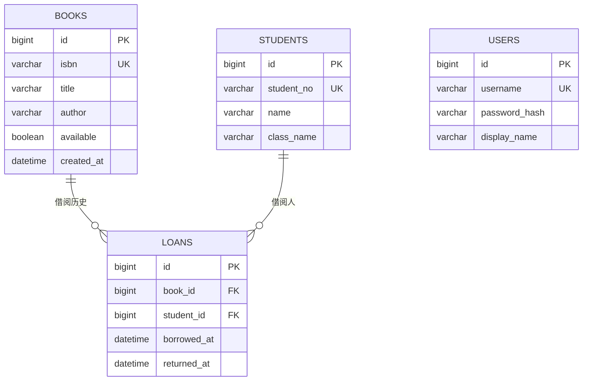

# JavaWeb 图书管理系统

基于 Servlet、MyBatis、MySQL 和 Thymeleaf 的个人学习项目，包含图书管理、学生查询、借阅归还，以及演示 JavaWeb 基础知识的开发者实验室。

## 环境与配置

当前环境为 **JDK 25.0.1、Tomcat 11.0.24、MySQL 9.7.1**，代码编译目标为 Java 17。依赖版本见 [pom.xml](pom.xml)，Maven Wrapper 为 3.9.6。

首次使用时复制数据库配置样例，再填写账号；已有本地配置可跳过复制：

```bash
cp config/database.example.properties config/database.local.properties
```

默认连接 `192.168.31.141:3306/study`。本地配置被 Git 忽略，不会打入 WAR。新建环境需先创建并选中数据库，再执行 [schema.sql](schema.sql)。

## VS Code 使用方法

使用 **Maven 打包 → Servers 面板部署、启动和停止** 的流程。

### 1. 打开项目

1. 选择 **文件 → 打开文件夹**，打开包含 `pom.xml` 的 `JavaWebLearning` 文件夹。
2. 安装 **Extension Pack for Java** 和 **Community Server Connector**，等待 Java 项目导入完成。
3. 在项目终端执行 `java -version` 和 `./mvnw -version`，确认 Maven 使用的 JDK。当前 JDK 25 可沿用，无需修改项目的 `release=17`。

### 2. 配置 Tomcat

在 **Servers** 面板使用已有的 `Tomcat 11.x`。若尚未添加，使用 **Add Server Location** 选择 Tomcat 安装目录（本机为 `/opt/homebrew/opt/tomcat/libexec`）。

如果 Tomcat 正在运行，先右键选择 **Stop Server**，再右键 → **Edit Server**：

- 将 `vm.install.path` 设置为本机 JDK 目录。
- 在 JSON 最外层添加 `mapProperty.launch.env`，为 Tomcat 指定数据库配置文件的绝对路径。

本机配置片段如下，合并到已有配置中，其他字段保留；属性之间注意逗号：

```json
"vm.install.path": "/Library/Java/JavaVirtualMachines/jdk-25.jdk/Contents/Home",
"mapProperty.launch.env": {
  "JAVAWEB_DB_CONFIG": "/Users/elaina/Desktop/Javaweb/JavaWebLearning/config/database.local.properties"
}
```

按 `Cmd+S` 保存，重新打开 **Edit Server** 确认配置已保留。这些路径属于个人服务器配置，其他电脑需按实际位置填写。只在终端中设置环境变量，不能保证 Servers 面板启动的 Tomcat 继承它。

### 3. 打包并添加部署

在项目终端执行：

```bash
./mvnw clean package
```

Windows 使用 `mvnw.cmd clean package`。等待最后出现 **BUILD SUCCESS**，生成 `target/javaweb-library.war`；单独执行 `clean` 只会删除构建产物。

1. 右键 **Tomcat 11.x 这一行** → **Add Deployment**，选择 `target/javaweb-library.war`，不要选择源码目录或旧的 `demo`。
2. 确认 Tomcat 下方出现当前 WAR，再右键 Tomcat → **Publish Server (Full)**，等待发布完成。
3. 右键 → **Start Server**，通过 **Show Output Channel** 查看启动日志。
4. 启动完成后访问 [图书管理系统](http://localhost:8080/javaweb-library/)，使用 **`admin` / `admin123`** 登录，再查看图书、学生列表，确认数据库连接正常。

已有的旧 `demo` 不代表当前项目已部署。添加部署用于登记 WAR，Publish 才会同步部署内容。

### 4. 修改、停止与调试

修改 Java、模板、CSS 或 JavaScript 后，按以下顺序操作：

**Stop Server → `./mvnw clean package` → Publish Server (Full) → Start Server → 刷新网页。**

也可按 `Cmd+Shift+P` → **Tasks: Run Task** → **JavaWeb: package** 完成打包；**JavaWeb: test** 用于运行单元测试。单独打包不会更新 Tomcat 中的应用，Thymeleaf 页面需通过 Tomcat 访问。

调试时，停止普通运行的 Tomcat，改用面板的 **Debug Server**。在 `BookServlet.doGet` 和 `BookService.search` 内设置断点，连接调试器后访问图书页面。若扩展没有自动连接调试器，可在“运行和调试”中添加 Java 附加配置，主机填写 `localhost`，端口以扩展实际启动的调试端口为准。

暂停后可查看 **Variables**、**Call Stack**，使用 **Step Over**、**Step Into** 和 **Continue** 跟踪请求；浏览器在断点期间等待是正常的。结束使用时通过面板 **Stop Server** 停止 Tomcat。

### 常见问题

| 情况 | 处理方法 |
| --- | --- |
| 测试报 `NoClassDefFoundError` 或找不到 `mybatis-config.xml` | 若源码存在但构建产物时有时无，可先排查 Java 自动构建与 Maven 同时更新输出目录：打开设置 → 工作区，搜索 `java.autobuild.enabled` 并取消勾选，等待当前构建结束，再单独执行 `./mvnw clean package`。这是排查步骤，尚不能仅凭该报错确定原因；不要跳过测试来打包。 |
| `BUILD FAILURE` | 查看第一处错误；开头的 JDK `WARNING` 不等于构建失败。打包成功后再部署。 |
| `404` | 确认已添加并发布 `javaweb-library.war`，访问路径为 `/javaweb-library/`；若仍失败，检查应用启动日志。 |
| `ERR_CONNECTION_REFUSED (-102)` | 检查 Tomcat 是否仍在运行、启动日志是否报错，以及访问端口是否正确。 |
| 数据库配置或连接失败 | 检查 Edit Server 中的 `JAVAWEB_DB_CONFIG`、本地配置文件和数据库网络连接；修改服务器环境变量后需重启 Tomcat。 |
| `8080` 被占用 | 确认占用进程属于哪个服务，再停止不需要的实例，避免多个 Tomcat 同时使用同一端口。 |
| 修改后页面没有更新 | 确认已重新打包、Publish，再启动和刷新。 |

项目任务仅保留测试和打包；启动、停止、发布和调试统一通过 Servers 面板操作。

## 功能与业务规则

| 页面 | 功能 |
| --- | --- |
| `/books` | 按书名、作者或 ISBN 搜索，筛选可借／借出状态，添加和删除图书 |
| `/students` | 按学号、姓名或班级查找学生 |
| `/loans` | 登记借阅、归还，筛选借阅中／已归还记录 |
| `/lab` | HTTP、Servlet 生命周期、Cookie、Session、XHR、转发与重定向、上传下载、JSP 和类加载器演示 |

- 每个 ISBN 对应一本可借图书；只有**从未借阅**的图书允许删除，归还后的历史仍保留。
- 借阅与归还使用事务更新图书状态和借阅记录；行锁防止并发重复借阅。
- 搜索条件通过 GET 参数保留；表单失败保留输入，成功后重定向，避免刷新重复提交。
- 管理功能需登录；实验室可直接访问，各卡片提供“操作与观察”说明。

## 代码与数据关系

| 目录 | 职责 |
| --- | --- |
| `src/main/java/com/example/demo/` | `servlet` 处理请求，`service` 管理业务与事务，`mapper` 执行 SQL；另含实体、过滤器、监听器与工具类 |
| `src/main/resources/` | Thymeleaf 模板、MyBatis 配置与 XML Mapper |
| `src/main/webapp/` | CSS、JavaScript、JSP 与 `web.xml` |
| `src/test/java/` | 单元测试与可选数据库集成测试 |

### 数据关系图



- `PK` 为主键，`UK` 为唯一键，`FK` 为外键。
- `loans.book_id` 关联 `books.id`，`loans.student_id` 关联 `students.id`；一本图书或一位学生可以有多条历史借阅记录。
- `returned_at` 为空表示尚未归还。外键使用 `ON DELETE RESTRICT`，防止删除仍被借阅历史引用的图书或学生。
- `users` 保存管理员登录账号；`students` 是借阅学生名录，两者没有外键关联。

### 一次借阅的调用链

1. `loans.html` 将图书与学生编号提交到 `POST /loans/create`。
2. 编码/日志 Filter 设置字符集，认证 Filter 检查登录态。
3. `LoanServlet` 解析并校验编号，调用 `LoanService.borrow`。
4. Service 打开手动提交事务，`BookMapper.findByIdForUpdate` 锁住图书行。
5. 检查图书、学生和借阅状态，再通过 Mapper 写入借阅记录，并将图书标记为借出。
6. 两步写入成功则提交事务；任一步失败则回滚。
7. Servlet 写入操作反馈并重定向到列表，浏览器重新 GET，由 Thymeleaf 渲染页面。

## 测试与打包

```bash
./mvnw test                        # 单元测试，不连接数据库
./mvnw clean package               # 清理、测试并生成 target/javaweb-library.war

# 可选：真实数据库集成测试
JAVAWEB_RUN_DB_TESTS=true ./mvnw -Dtest=DatabaseIntegrationTest test
```

集成测试创建随机命名的 `javaweb_test_<UUID>` 数据库，验证外键、并发借阅、回滚和搜索，结束后自动删除，**不写入 `study`**。账号需有创建/删除测试库和触发器的权限；若测试被强制中断，可按日志中的精确名称清理遗留测试库。

## 学习参考

- [柏码 JavaWeb 教程](https://www.itbaima.cn/zh-CN/document/ycpagby2v7j4p728)
- [配套视频](https://www.bilibili.com/video/BV1CL4y1i7qR/)
